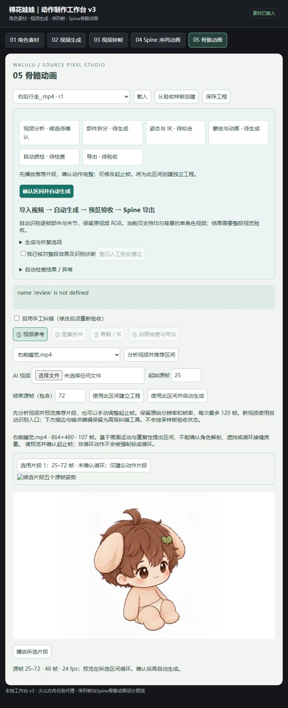
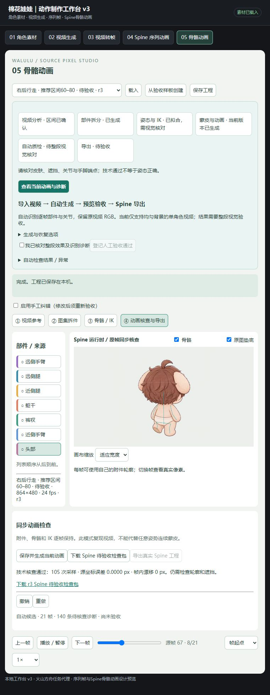

# 05 骨骼动画｜自动化操作手册

更新：2026-11-20 · 按当前工作台按钮编写

**你负责：选视频、确认片段、核对效果和验收。系统负责：识别、拆件、IK、绑定、动画、质检与真实 Spine 导出。**

工作台：http://127.0.0.1:8770/studio_v3/#spineRig

开始前：使用均匀背景、单角色 AI 视频；文件不超过96 MB，分析视频不超过60秒，每次制作1–120帧。首次体验建议选右后行走。

## 1. 选一个 AI 视频

进入“视频参考”。在“已导入的视频”下拉框选视频，或者点击“AI 视频”上传新文件。

**下一步：** 点击“分析视频并推荐区间”。

**看到的结果：** 看到候选片段、五帧对照图和视频预览。

提示：换视频时从这里开始，不使用“从验收样板创建”。

## 2. 预览并确认动作区间

点击一个“选用片段”按钮，再点“播放所选片段”。查看动作是否完整；行走要特别观察末尾回到开头是否自然。

**下一步：** 满意后点顶部“确认区间并自动生成”，或“使用此区间并自动生成”。

**看到的结果：** 系统建立独立工程并开始处理。

提示：可以修改起始源帧和结束源帧（包含）。例如60–80共21帧。候选是建议，不是验收结果；“未确认循环”可用于睡觉等非循环动作。

## 3. 等待自动制作完成

系统依次执行逐帧部件与关节识别、原像素分割、整段 IK 拟合、附件绑定、同步动画生成与质检。

**下一步：** 查看进度即可；无需逐部件点击确认。

**看到的结果：** 完成后自动进入“动画核查与导出”。

提示：正常流程不需要启用手工纠错，也无需另外点击“生成动画预览”。刷新可恢复进度；失败后点击“重试 / 继续自动生成”。

## 4. 在工作台检查整段效果

先以1×播放，再用0.25×慢放；必要时使用上一帧、下一帧和时间轴。展开“自动检查结果 / 异常”，打开完整周期逐帧对照。

**下一步：** 重点核对手脚像素、裤衩遮挡、关节位置和首尾衔接。

**看到的结果：** 确认没有明显缺失、错配、拉扯或关节漂移；不能仅凭皮肤重合判断 IK 正确。

提示：“图集拆件”可用部件归属着色、仅选中部件查看附件；“骨骼 / IK”默认只读检查。“原图垫底”可开关对照。

## 5. 下载检查包，在 Spine 验收

在“动画核查与导出”点“下载 Spine 待验收检查包”。等生成成功，再点击出现的下载链接。

**下一步：** 解压整个 ZIP，保持目录结构。在 Spine 4.2.43 中打开 walk.spine，选择 reference_cycle，点击动画左侧圆点激活后播放。

**看到的结果：** 核对整段动作、附件完整性、裤衩与腿的层级，以及骨骼和 IK 是否跟随肢体。

提示：检查包可在未验收时下载。成功导出、技术核查通过，不代表美术和动作验收通过。不要只移动 .spine 文件而丢失贴图。

## 6. 登记验收并导出正式包

只有你确认效果符合要求后，回到同一工程、同一版本。勾选“我已核对整段效果及识别诊断”。

**下一步：** 点击“登记人工验收通过”（顶部主按钮也可能显示“登记整段验收通过”），然后点“导出已验收版本”或“导出真实 Spine 工程”。

**看到的结果：** 等待真实 Spine 导入回导检查结束，点击正式 ZIP 下载链接保存交付。

提示：结构错误会阻止验收；不能为了导出直接勾选。修改输入、重新生成或换视频后需要重新检查，不能沿用原验收。

## 只检查这四件事

- **像素与轮廓：** 手掌、脚掌有没有缺失或残边；不要把裤衩、躯干像素误分到手脚。

- **遮挡与层级：** 裤口与大腿衔接是否自然；远侧手、远侧腿是否在正确前后层。

- **关节与 IK：** 肩、髋、肘、膝和手脚端点是否跟随视频；有没有突然翻转、漂移或异常拉长。

- **动作与循环：** 整段节奏是否符合视频；行走首尾是否跳变。非循环动作不要求强行闭环。

## 常见问题

### 按钮灰色，无法正式导出

先生成当前版本并完成验收。未验收时应使用“下载 Spine 待验收检查包”。

### 长时间停在某一帧

查看进度提示，视觉识别可能耗时或重试。任务明确失败或中断后，再用“重试 / 继续自动生成”；不必反复新建工程。

### 刷新页面后去哪里找结果

从顶部“已保存工程”选择工程并点“载入”。核对名称与 r 版本号；当前版本已生成的下载链接会恢复。

### 检查发现缺陷怎么办

先记下源帧号、部件和现象，不登记验收。可反馈问题继续修正；高级用户可启用手工纠错，但修改后须重新生成和验收。

### 每帧显示“待审核”，是否还要逐个确认

自动候选按整段视觉验收，不要求逐部件点确认。部件旁的标记不能替代整段验收状态。

### 可以换一个视频直接做吗

可以从第1步重新分析。复用的是流程规范；新视频的部件、骨骼和节奏重新识别，不继承旧素材或旧验收。

## 当前效果边界

原像素附件逐帧同步，保留视频细节，不补画；这不是可随意摆出新姿势的连续蒙皮角色。循环区间由画面运动与重复性推荐，仍需核对。当前右前、右后旧行走版本已验收；新推荐区间60–80帧仍待验收，睡觉仅验证了选段与预览，不能视为整套骨骼效果已合格。

2026-11-21 更新：可直接在载入工程后手动改起止帧，按自选区间建立独立工程。界面按选段、生成、检查、检查包、验收、正式交付排序。图集报告显示页数与基础RGBA占用；当前逐帧模式不等于可复用换装资产。详细自查见 `05_SELF_AUDIT_20261121.md`。
